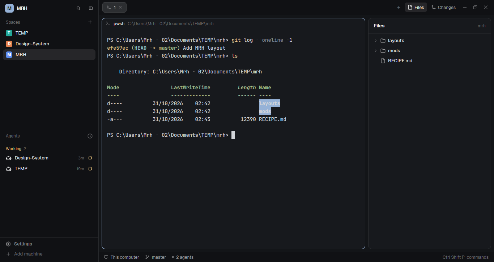

# MRH

A Herdr window with a personal monogram header, your spaces and agents on the left, a card-like terminal in the middle and Herdr's Files panel open on the right. Everything Herdr ships stays reachable: the tab bar with its Files and Changes buttons and + menu, pane headers, the status bar, Settings and Add machine. The layout brings no colours of its own — it draws with the current theme, so the monogram tile, focus rings and selected buttons take the person's accent.



## What you see

Left to right, at zoom 1 (a 1280×728 window):

- **Sidebar — 272 px** wide, `chrome` background, full height:
  - **Header — 46 px**: a 24 px `accent` tile, 6 px radius, with "M" in 13 px semibold `accent_foreground`; then "MRH" in 12.5 px semibold `foreground`. At the right two 26 px buttons, 6 px radius, 14 px `currentColor` SVG glyphs in `muted` (magnifier, sidebar outline); they take a `hover` background and `foreground` glyph on hover.
  - **Spaces — weight 1, min 90 px**: Herdr's spaces list, unchanged (header with count and +, rows with the space's color tile, name and status).
  - **Agents — weight 1, min 90 px**: Herdr's agents list, unchanged (grouped by priority by default: Needs you, Done, Working, Idle).
  - **Footer — 69 px**: Herdr's Settings and Add machine rows.
- **Tab bar — 42 px** over the work area: the shown space's tabs as pills (29 px tall, 10 px side padding, 7 px radius, 12.8 px text); the active tab is `raised` with `foreground` text and a `border` outline, the others sit on `chrome` with `muted` text. A working tab shows a 12 px spinner, a blocked or done tab a 6 px dot in `blocked`/`done`; the close × is on the active tab only. Then + , Files and Changes buttons (26 px, `selected` background when their panel is shown) and, on Windows and Linux, the window's minimize/maximize/close buttons. On macOS the traffic lights sit over the layout and the bar starts after the sidebar.
- **Work area**: 8 px padding and 8 px gaps around one card. A card is `background` with a 1 px `border` outline, 10 px radius; the focused card's outline becomes 1 px `accent`. Its 30 px header (Herdr's `pane` mod) shows the program icon, the terminal title, the live folder, the agent's status and, on hover, split-right/split-down/zoom/close buttons. Splits add more cards with the same 8 px gap.
- **Panel — 340 px** wide (min 280, max 900) on the right, draggable on its left edge: the `panel-body` stack with Herdr's `files` mod shown. The Files card fills it: `background`, 1 px `border`, 10 px radius, a 42 px header, folder/file rows and read-only previews. Changes shares the slot and adds the diff list and commit message input. On a space with no remembered choice the panel is open on Files.
- **Status bar — 28 px** at the bottom, `chrome` with a 1 px top border: the machine, the branch when there is one, "N agents", "· N needs you", and the Ctrl Shift P hint on the right.

All colours are theme tokens (`canvas`, `chrome`, `background`, `border`, `foreground`, `muted`, `dim`, `accent`, `accent_foreground`, `selected`, `hover`, `working`, `blocked`, `done`, `idle`). The layout sets no `theme`, `colors`, `font` or `font_size`: the UI font, terminal font, sizes and every colour come from settings.json and the theme picker.

## How it behaves

- **Agent statuses** (Herdr's shipped mods draw all of them; the layout adds nothing):
  - *working* — 12 px ring spinner in the agents list and tab pill (0.9 s turn) and in the pane header, `working` colour.
  - *blocked* — "Needs you" pill (`blocked` text on a 15% `blocked` wash) in the pane header and agents list, a `blocked` dot on the tab, counted in the status bar's "needs you".
  - *done* — a `done` dot in the pane header and tab; listed under Done in the agents list; not counted by the status bar.
  - *idle* — listed under Idle; no tab or pane indicator.
  - A space's dot is its most urgent agent's status (`blocked > done > working > idle`).
- **Sidebar header**:
  - The magnifier opens Herdr's terminal picker (`mod.open {name: "picker"}`); the sidebar button collapses the sidebar to a 44 px rail (76 px on macOS) and expands it back to the width it had (272 the first time).
  - Both buttons stop the mouse press (`cx.stop_propagation()`), so the 46 px block only window-drags where there is no button. Double-clicking the block maximizes the window like any `window_drag` block.
  - Below 160 px the header drops the wordmark and both buttons and keeps only the M tile (on macOS it draws nothing at all, because the traffic lights fill the rail). Spaces and agents switch to their own compact rails at the same width.
- **Tabs**: click selects, double-click renames (`tab.rename`), dragging reorders (`tab.move`), the wheel over the bar goes next/previous, × closes (`tab.close`), + opens Herdr's new-menu popup at 250×512 (terminal or any installed agent). Files switches the panel to Files, Changes to Changes; clicking the shown one hides the panel (`layout.hide`). Herdr's tabs mod remembers the panel's shown/closed state and which of the two for each space in its own localStorage, so each space keeps its choice.
- **Spaces and agents**: Herdr's lists — click a space to show it, right-click for its menu, drag to reorder; click an agent to focus it. Agent next/previous keys follow the agents list's order.
- **Pane**: clicking a card focuses it; the header's hover buttons split it right or down, zoom it and close it. Panes can be dragged by the app's top-center grip into a split or another tab.
- **Panel**: Files rows expand folders and open a bounded read-only preview; Changes shows git changes and commits from its input. Both follow the focused pane's folder and refresh on a folder watch plus a 10 s timer. The panel's left edge resizes it (280–900 px). The Files panel handles Windows paths with spaces, parentheses and apostrophes.
- **Keys**: the layout ships no `keys.json`. Herdr's defaults apply, including `ctrl-shift-l` (switch layout), `ctrl-shift-b` (hide/show the whole `sidebar` node), `ctrl-shift-p` (palette), `alt-up`/`alt-down` (previous/next agent), `ctrl-shift-o`/`ctrl-shift-e` (split right/down), `ctrl-shift-z` (zoom), `ctrl-shift-x` (close pane), `ctrl-shift-w` (close tab), `ctrl-shift-t` (new tab), `f2` (rename tab), `shift-f2` (rename space). The header's rail toggle is click-only.

## Built from

One layout file, one mod, and Herdr's own mods.

```
root  row, titlebar "none", traffic_lights [12,16], preview layouts/MRH.svg,
      background canvas, terminal_padding [14,12], divider 1 border
├─ sidebar  column, 272 px, min 44, max 480, background chrome, resizable false
│  ├─ brand           block, 46 px, window_drag, { mod: "mrh-brand" }
│  ├─ sidebar-lists   column
│  │  ├─ spaces       block, weight 1, min 90, { mod: "spaces" }
│  │  └─ agents       block, weight 1, min 90, { mod: "agents" }
│  └─ sidebar-footer  block, 69 px, { mod: "workspace-chrome", props: { footer: true } }
└─ work  column, resizable false
   ├─ tabs            block, 42 px, window_drag, { mod: "tabs" }
   ├─ work-body       row, padding 8, gap 8
   │  ├─ main        block, { tab: "active", pane: … }
   │  └─ panel       column, 340 px, min 280, max 900
   │     └─ panel-body  stack, active "files" { files, changes }
   └─ status          block, 28 px, { mod: "workspace-status" }
```

The pane block's `pane` object: `{ gap: 8, radius: 10, background: "background", lone: true, border: { width: 1, color: "border" }, focus: { width: 1, color: "accent" }, header: { content: { mod: "pane" }, height: 30, position: "top", reveal: "always" } }`.

- **`mods/mrh-brand/`** (new; `mod.json` is `{"place":"none"}`, so it only lives where a layout puts it):
  - `main.js` exports a `View` with one `render()`. It reads `theme()`, `window()`, `layout()`; calls `run("mod.open", { name: "picker" })` and `run("layout.resize", { id: "sidebar", px })`; reads/writes `shared("sidebar.width")` + `setShared`. It draws with `h_flex`, `div`, `svg`.
  - `narrow()` walks `layout()` to node `"sidebar"` and compares `size.px < 160`; `toggleSidebar()` saves the current width in `shared("sidebar.width")` when wide and resizes to 44 (76 on macOS) or back to the saved width, else 272.
  - `search.svg` and `sidebar.svg` are 16×16 one-colour glyphs, drawn at 14 px and tinted by `text_color` (`svg()`).
  - No `init`, timers, `exec`, `fetch`, file reads or network.
- **Herdr's mods used:** `spaces`, `agents`, `tabs`, `pane` (the pane header), `files`, `changes`, `workspace-chrome` (footer only), `workspace-status`; `new-menu` (the + button), `picker` (the magnifier) and the default `menu` (terminal right-click) open from them.
- **Commands the layout depends on:** `tab.select`, `tab.rename`, `tab.close`, `tab.move`, `tab.next/prev`, `tab.new` (new-menu), `pane.focus/split/zoom/close`, `space.select`, `agent.focus`, `layout.resize`, `layout.show/hide`, `layout.select`, `mod.open`, `window.minimize/maximize/close`.
- **Art:** the two SVGs above; the monogram and wordmark are text. `layouts/MRH.svg` is the picture Settings shows for this layout (schematic, not a live capture).
- **Programs:** the layout runs none. Herdr's `files` mod runs PowerShell on Windows (`Get-ChildItem`) or `sh` elsewhere to list folders, and `changes` runs `git`; both read the focused pane's folder.

## Watch out

- **Node ids are load-bearing.** Herdr's shipped mods find `sidebar` (rail rules), `panel` and `panel-body` (Files/Changes buttons) by id. Renaming or removing them breaks the rail and the panel buttons.
- **Don't edit Herdr's mods or layout.** The layout references the shipped names; if you need to change one of those mods, clone it (`mod.clone`) and point the layout or that block at the clone.
- **The layout has no look of its own.** Adding `theme`/`colors` to the root would override the person's theme picker. If you do, keep `accent_foreground` readable on `accent` and check a light theme.
- **macOS:** `titlebar` is `"none"` and `traffic_lights` is `[12,16]`; the header pads 78 px so it starts after the lights. On the collapsed macOS rail the header draws nothing. Window buttons come from Herdr's tabs mod only when `window().buttons` is true (Windows/Linux).
- **The panel's open state is per space**, kept by Herdr's tabs mod: the layout's "open on Files" is what a space with no stored choice gets; a space that closed it stays closed. To force it: `layout.show {id: "panel"}` then `layout.select {stack: "panel-body", child: "files"}`.
- **Sizes:** 272 + 340 px leave about 660 px for the terminal in a 1280 px window; the panel can shrink to 280 and the pane area gives way. The sidebar is fixed at 272 unless collapsed; drag its edge only after setting `resizable`.
- **No custom keys.** `ctrl-shift-b` hides the whole sidebar node (Herdr's default `layout.toggle:sidebar`) with no on-screen way back except the same key — that is Herdr's behavior, not this layout's rail button.
- **No update badge** in the header (Herdr's workspace-chrome brand has one). Settings still shows updates.
- The mod folder Herdr writes `gpui-kit.d.ts` and `jsconfig.json` into is generated; don't ship or edit them.

## Done when

- `herdr-app check ~/.config/herdr-app/mods/mrh-brand` exits 0.
- With `layouts/MRH.json` and `layouts/MRH.svg` in `layouts/` and `mods/mrh-brand/` in `mods/`: `herdr-app do layout.switch --name MRH` shows the M/MRH header, spaces above agents, the tabs bar, one terminal card, the Files panel on the right and the status bar; `herdr-app status` reports no errors.
- Clicking the magnifier opens the terminal picker; clicking the sidebar button gives a 44 px rail with only the M tile (76 px and nothing but the traffic lights on macOS), and clicking it again returns to 272 px.
- Files shows the focused pane's folder; Changes shows git changes for it; clicking the shown button hides the panel; switching spaces restores each space's own choice.
- On the tab bar: the active tab has the only ×, double-click renames, dragging reorders, the wheel switches tabs, + opens the new menu, and the window buttons minimize/maximize/close.
- `herdr-app do app.theme --name paper` (and back to the previous theme) recolours the whole window — including the M tile — without editing the layout.
